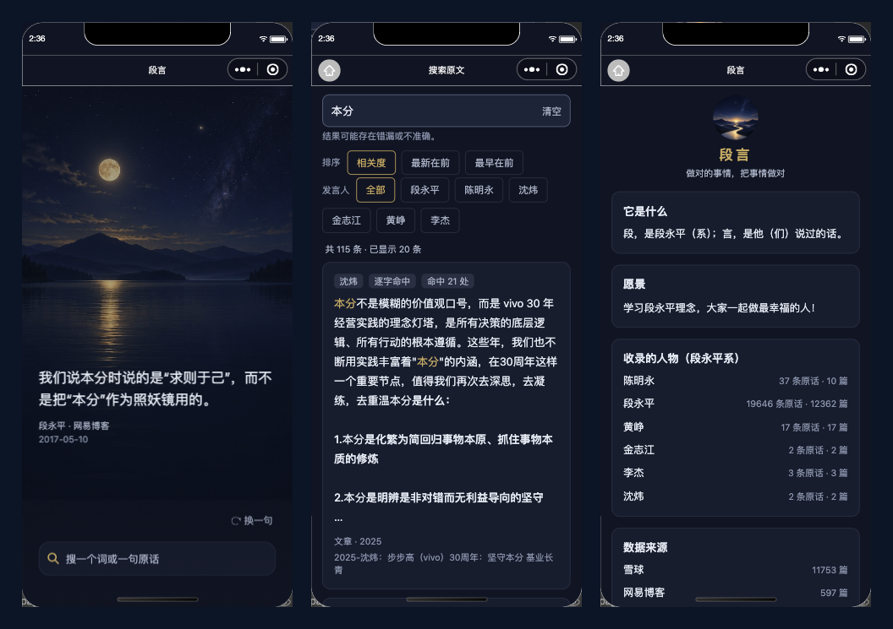

# 段言 · 微信小程序



把仓库里这套「大道：段永平（系）材料整理」变成可以**搜、可以看回原文**的小程序：
只放他（们）自己说过的话，逐字照录，每条都带出处；不生成、不改写、不概括。

## 五个页面

- **主页**：每天一条原话（可「换一句」、长按复制「原文 + 出处」）。背景是 AI 画的海报，不是实景照。
- **搜索**：全文检索 + 排序（相关度 / 最新在前 / 最早在前）+ 发言人筛选；命中处高亮，
  长片段自动把命中收进前两行（其余用「…」省略），一段里命中多次会标「命中 N 处」。
- **原文页**：按段落读，可「加载更早 / 后续的段落」，命中处高亮，并标出**他这条是在回复谁**；
  另有「原文链接」与「报错 / 纠错」。
- **专题**：按主题看一组核验过的原文（如「做对」）。
- **关于**：收录范围、人物与数据来源。

## 目录

```text
duanyan-weapp/
├── project.config.json        微信开发者工具项目配置（miniprogramRoot 指到 miniprogram/）
├── miniprogram/
│   ├── config.js              运行时配置：改成你自己的后端地址与 token
│   ├── assets/                海报与 logo
│   ├── data/hero-quotes.js    首页「今日一条」的随包清单（人工核过，不发请求）
│   ├── pages/                 index / search / reader / topic / about
│   ├── templates/             公共 wxml 片段
│   └── utils/
│       ├── api.js             后端接口客户端（接口契约都在这里）
│       ├── view.js            接口数据 → 视图模型（纯函数，可单测）
│       ├── quote.js           语录与版式相关纯逻辑
│       └── scroll.js          回到顶部用的滚动封装
├── tests/                     jest 单测（不需要 IDE）
└── docs/screenshot.png        上面那张三拼图
```

## 跑起来

1. 微信开发者工具「导入项目」选本目录（`project.config.json` 在根）。
   AppID 属于原项目，fork 时请换成自己的（或先用「测试号」）。
2. 编辑 `miniprogram/config.js`，填上自己的后端地址（以及后端要求的 token）。
3. 本地校验（不需要 IDE、不需要登录）：

   ```bash
   npm install
   npm run check        # tsc 类型检查 + jest 单测
   ```

## 说明

- **只有小程序端**。检索后端不在本仓库；接口契约见 `miniprogram/utils/api.js`
  （`/api/v1/retrieve/passages` 等），自己实现一套满足契约的后端即可。
- **内容版权归原作者与原平台**。本仓库只做检索与呈现，正文逐字照录、不改写；
  转录稿未经逐字人工校对，可能有错漏，一切以原视频/原文为准。发现问题欢迎提 issue。
- 展示层只做取舍、不改字：原文里的 `**强调**` 渲染成粗体，命中词只改颜色、不改字号。
