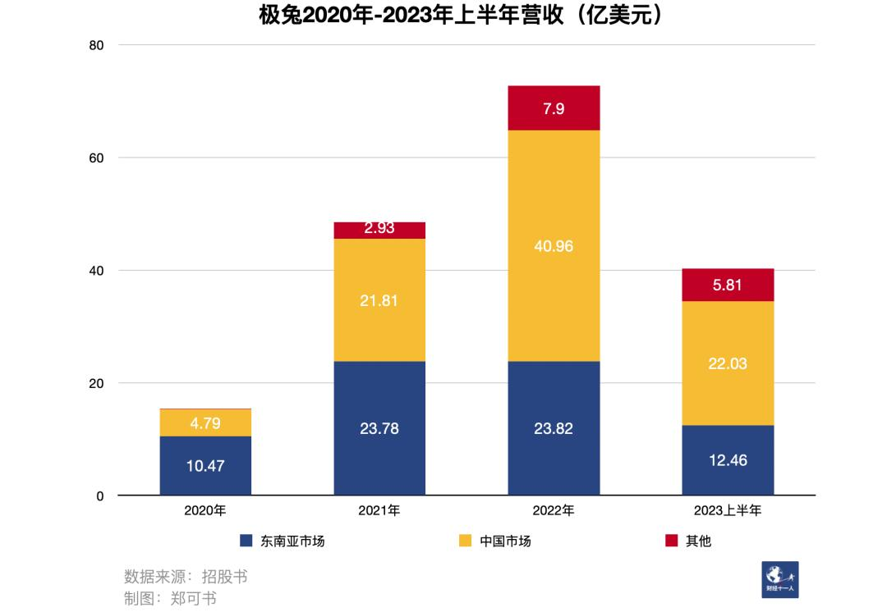
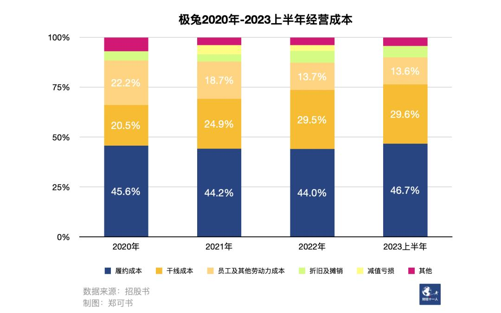

# 极兔上市之路：人脉、资本和时机

[极兔上市之路：人脉、资本和时机-36氪](https://36kr.com/p/2492375747139719) 2023年10月27日

人脉、资本与对时机的把握，让极兔占领东南亚市场第一，并以后来者的姿态，在中国红海市场中挤入前五。但这些因素的助力有限，规模、成本、效率是极兔未来发展的关键。

10月27日，极兔 （1519.HK） 在港交所上市，市值超过1000亿港元。

创始人李杰没有前往香港敲钟现场。“我们在每个国家都是‘土匪’” ，他在极兔上海总部发表内部讲话，“要么开疆拓土，要么抢占别人的市场份额”。

极兔自印度尼西亚起家，是如今东南亚市占率第一的快递公司，并于2020年进入中国。彼时中国快递市场已是一片红海，五家头部企业把持超过70%的市场份额。面对通达系 （中通、圆通、韵达、申通等头部快递企业，他们与阿里关系密切，承担大量淘宝、天猫的订单） 的围剿，极兔仅用三年，就跻身行业第五。据国家邮政局，2023年上半年，极兔的市场份额达到11.7%。

但资本市场反应平平。此次IPO （首次公开募股） ，极兔预计募资35.28亿港元。据《证券时报》今年6月的报道，极兔提交IPO申请时，计划募资5亿-10亿美元 （约39亿-78亿港元） 。极兔最新预计募得的资金，甚至低于此前计划的下限。

上市首日，极兔短暂破发。一位知情人士称，李杰在内部讲话中表示，短期股价不重要，看好极兔长期的成长性。

过往，极兔受到关注的另一个原因是李杰的前OPPO高管身份。OPPO、vivo是中国大陆一线手机制造商，均拆分自步步高集团；步步高创始人段永平也是小霸王创始人、拼多多天使投资人，拼多多创始人黄峥称其“对我的商业思想影响最大”。因此，它们被称作“步步高系”。极兔也成为步步高系人才创建的又一家大型企业。

外界对极兔的印象是激进与“低价”。但回溯极兔发展的节点，会发现关键词还有“人脉”“资本”和“时机”：

2015年，在东南亚电商刚刚起步、物流竞争对手寥寥时，极兔开启业务，通过OPPO人员与销售网点，建立起覆盖印尼的代理网络，并从中国招聘历经电商洗礼的专业人才，顺利搭上东南亚电商发#展的快车，确立优势；

2017年-2018年，极兔获得两轮总额1.83亿美元的投资，在之后两年内扩展版图，业务覆盖东南亚主要国家；

2020年，李杰通过段永平的撮合，获得拼多多订单，在新兴电商平台需要快递服务之时回到中国，依靠雄厚的资本，烧钱抢市场，“8毛发全国”；

2021年与2023年，极兔分别收购“通达系”之一百世的中国业务，以及顺丰旗下关注电商订单的子公司丰网，换得网点、人才与淘系 （即淘宝、天猫等阿里旗下电商平台） 订单，跻身中国快递市场第五。

“运气很好”，上市内部讲话中，李杰如此概括极兔的发展历程。也因此，极兔是一个难以复刻的独特故事，而它如今面临的挑战——如何守住份额，如何持续增长——与其他公司相似。在中国市场，极兔仍处毛损状态；在大本营东南亚，它又面对来自国内同行的挑战。在这个阶段，人脉、资本与时机能够提供的助力有限；规模、成本、效率，这些最基础的元素，成为决定极兔未来的关键。

## 1 将中国经验带到东南亚

投资机构ATM Capital创始人屈田第一次听说极兔，是在2017年。他问一家东南亚快递公司创始人，“印尼有东南亚最大的电商，为什么不把印尼单一市场做好？”对方答：“印尼有一家叫J&T （极兔的英文名） 的公司，我们打不过它。”以此为契机，ATM Capital成为极兔早期投资方。

屈田回忆，当时，成立仅两年的极兔日单量已达70万，而创立于1990年的老玩家JNE是100万单，极兔很快实现赶超。

极兔成立于2015年8月。那时，创始人李杰刚从OPPO辞职。他原为OPPO苏皖地区负责人，2013年来到印尼，任OPPO印尼公司第一任CEO，负责开拓东南亚市场。市场传闻称，当时，李杰发现印尼的快递物流服务质量低下，OPPO手机经常丢货少货，时效也慢，故决定与OPPO创始人陈明永 （现已辞任极兔董事职位） 创建快递公司。

但在上市当天的内部讲话中，李杰提到，创立原因没有那么复杂。2015年3月，他和陈明永在深圳聊了三个小时，就敲定快递创业计划。

公司名定为“J&T”，取自双方英文名的首字母 （Jet和Tony） ，同时象征“Jet” （喷气式飞机） 和“Timely” （及时） 、“Technology” （科技） 。

商务部数据显示，2015年中国电商交易额已达20.8万亿元，阿里巴巴、京东GMV （交易总额） 冲向万亿规模，电商的庞大需求将全年快递业务量推至206.7亿件的高峰。

而在东南亚，据数据公司Statista，主要六国 （印尼、泰国、越南、马来西亚、菲律宾、新加坡） 的电商GMV仅55亿美元。将在未来成为东南亚最大电商平台的Shopee刚刚创立，成立于2012年的Lazada将于次年被阿里巴巴收购，与Shopee开展争夺。

极兔总部设在印尼，业务也自印尼起步。一位接近印尼极兔的人士称，极兔起网依托于已有的OPPO网络——OPPO共有25个代理区，极兔创立初期，25个代理商一边做OPPO业务，一边做极兔快递，送OPPO的货。

与OPPO类似，极兔采用“区域代理模式”。据招股书，极兔的国家总部负责制定市场运营策略及执行计划；区域代理负责区域日常运营，聘请与管理加盟网络合作伙伴 （即揽件、派件网点） ，或直接运营相关网点。国家总部和区域代理共同运营转运中心及干线运输车辆、路线。

相较于通达系采用的加盟模式 （也称“网络合作伙伴模式”，总部运营转运中心与干线运输，第三方加盟商运营揽件、派件网点及服务站） ，极兔总部与基层网点之间多了一层“区域代理”。区域代理与总部共享利益，且具有相当的自主权。据招股书，区域代理通常持有相关运营实体及/或极兔国家公司的少数股权，须为当地业务投入资金、人脉关系 （拓展客户） 等资源。总部通过股权投资和贷款的方式，对区域代理拨款。上述接近印尼极兔的人士称，区域代理实体自负盈亏、总部抽成。

OPPO现有人员之外，极兔还从中国招聘快递专门人才。这些人已在中国受过十余年的电商洗礼，具备提升效率的模式、技术经验。据国家邮政局，2015年，中国快递服务全程时限均值为59.2小时，也就是两天半。

未经历过电商教育的印尼本土公司，无法与之竞争。上述接近印尼极兔的人士称，以前在印尼境内，外岛包裹要走海运，全程耗时一个月；极兔通过海陆空等交通方式组合、环节优化，将时间缩短到半个月甚至一周。一位行业人士评价，中国快递业到了海外市场，硬件、软件、经营理念，都具备碾压式的优势。

与此同时，东南亚电商开始快速起量。据第三方机构iPrice数据，2017年东南亚一手商品电商GMV超过100亿美元，而2015年的数据为55亿美元，年复合增长率41%。

屈田回忆，当时印尼传统物流公司的服务、效率都跟不上电商的发展速度，无法满足商家和消费者的需求。这部分需求被极兔承接。上述接近印尼极兔的人士称，前期，印尼极兔90%以上的订单来自Shopee。

站稳脚跟后，极兔获得资本的青睐。2017年7月、2018年8月，极兔进行Pre-A1和Pre-A2轮融资，金额分别为1.03亿美元和8000万美元。融资后估值达5.82亿美元。

此后，极兔开始扩展版图：2018年进入越南、马来西亚，2019年进入柬埔寨、菲律宾、泰国，2020年进入新加坡。至此，极兔覆盖东南亚主要国家。

这轮扩张同样踩准时机，搭上了东南亚电商发展的快车。谷歌、淡马锡与贝恩联合发布的《2022东南亚数字经济报告》显示，2017年至2022年，东南亚电商GMV从109亿美元上升至1310亿美元，年复合增长率达64%。

极兔业务量同步高速增长。据招股书，2020年和2022年，极兔分别在东南亚处理11.54亿件和25.13亿件包裹，复合年增长率47.6%。2020年-2022年，极兔在东南亚市场盈利，三年经调整EBITDA（税息折旧及摊销前利润） 共计10.26亿美元。2022年，极兔在东南亚市场份额达22.5%，是第二名的3倍。

## 2 中国市场的搅局者

东南亚地盘稳固后，极兔将目光投向中国。多位人士告诉《财经十一人》，关于是否回到中国，极兔内部争议很大，反对者认为中国快递市场竞争太激烈、太烧钱，成功几率不高。

2019年，中国快递行业已经掀起价格战。据国家邮政局，当年快递单件价格11.5元，同比下降12.9%；而2015年-2018年，快递平均单票收入在12元-14元。订单集中在头部玩家手中，收入排名前八企业占据的市场份额超过80%。

另外，头部快递企业通达系与阿里深度绑定，但新的电商平台正在涌现。成立于2015年的拼多多依靠下沉市场，在阿里、京东的夹缝中崛起，到2019年，年度GMV突破万亿元；据拼多多与京东财报，2018年拼多多的年度活跃买家数已经超过京东。同时，直播电商兴起，手握流量的抖音、快手入场。

最终，“回到中国”的观点占了上风。屈田回忆，极兔管理团队态度坚决，他们认为中国快递巨头们早晚要出海，进军东南亚市场；而且中国新崛起的电商平台，需要独立的第三方物流公司。

拼多多成为极兔回到中国的突破口。两位接近极兔的人士说，在进入中国之前，极兔已经拿到拼多多的订单。其中一位人士称，李杰当时鼓励一位代理商从印尼回到中国开拓市场，“放心，单量已经有了，尽管去做。”另一位极兔员工告诉《财经十一人》，极兔回国初期，拼多多的业务量占比超过九成，且极兔曾寻求与阿里、京东合作，均未能达成。

李杰曾在一次内部会上讲述获得拼多多订单的经过。一位知情人士称，段永平有在其中协商、撮合。

回到中国的行动开始了。2019年，极兔收购龙邦速运，获得快递经营资质；2020年3月，极兔开展中国业务。上述两位接近极兔的人士称，开拓市场时期，中国的区域代理多由印尼区域代理回国担任；他们中的很多人，从OPPO时期就追随李杰，赚到了钱，因此他们信任李杰。

其中一位人士回忆，区域代理背负任务，要在一定期限内完成区域内网络全覆盖，未达标就要受罚，比如缩小代理区域、缩减股票期权；部分区域代理与总部签订对赌协议。

该人士告诉《财经十一人》，区域代理们起网的方法之一，是寻找全峰、国通等当时经营状况堪忧的快递，说服加盟商加入，但他们发现，这些品牌实力不够；后来，极兔尝试寻找顺丰的员工，又发现做直营的人做不好加盟。最终的办法是，劝说通达系加盟商同时运营极兔业务，话术是“万一哪天你被通达抛弃了，多一个品牌，多一个考虑”。

价格补贴是极兔最有力，也是最惹人注目的武器。一位知情人士称，极兔给出更高的派件费用，以笼络加盟商。

至于客户端，在重要“产粮区” （即寄件需求量大的地区） 浙江义乌，通达系的寄件收费在每单1.4元，而极兔的价格低于1元，甚至可以“8毛发全国”。据招股书，2020年，极兔中国市场单票收入23美分，成本51美分，即每送一单，就亏损22美分 （约1.6元） 。

2020年下半年，圆通、申通、韵达等通达系公司陆续“封杀”极兔，禁止加盟商加盟极兔、代理极兔业务。上述接近极兔的人士称，此次风波，反而为极兔打响知名度。有偏僻地区的人因此听说极兔，寻求加盟。到2020年底，回国三个季度后，极兔中国的包裹量达20.83亿件，占全国总数的2.5%。

2021年4月，极兔再次面对风波。因低价倾销，且未达整改要求，义乌邮政管理局责令极兔部分分拨中心停业整顿。

当时，百世快递 （BEST.N） 同样因低价倾销，被义乌邮政管理局要求整顿。与极兔不同的是，它最终被价格战拖垮。百世成立于2007年，是“通达系”成员之一，市场占有率常年排在前八。2020年，百世集团经营亏损16.9亿元，经营亏损率5.6%，而同样经历价格战的中通、圆通、韵达、申通虽利润缩窄，但仍保持盈利状态，经营利润率分别为16.6%、6.4%、5.3%、0.5%。次年，百世快递中国收入超过24亿美元，亏损约3.07亿美元，亏损率12.8%。

2021年，极兔以7.16亿美元的现金对价收购百世快递中国 （企业价值约68亿元） ，收购于当年12月完成。极兔就此获得百世的加盟网点、员工与淘系订单。

合并过程中，加盟商的融合是难题。两位知情人士称，同一个区域内，若有极兔、百世两个加盟网点，双方需要通过收购股权、拆分区域等方式进行整合。《证券日报》2022年1月曾报道称，收购过程中，百世大量网点混乱并停工，但公司对此不知情，导致大量快递滞留转运站，只能更换快递公司。

极兔为这笔收购付出的成本，并不止7.16亿美元。招股书显示，2021年、2022年与收购百世有关的整合成本，包括百世员工的离职补偿金，百世冗余的物业、厂房、设备及其他无形资产的减值等，分别为2.66亿美元和3.88亿美元。据此计算，收购百世的总成本约为14亿美元（约合88亿元） 。

但收购过后，极兔订单量的增幅不及预期。2021年，极兔中国包裹共83.34亿件 （包括极兔2021全年的包裹量，以及12月8日完成收购后，百世的包裹量） ；2021年前三季度，百世包裹量为61.6亿件，按照四季度包裹量占全年的四分之一计算，百世2021全年包裹量约82.13亿件。双方加总，共为165.47亿件。而2022年，极兔中国市场包裹量120.26亿件，仅占前一年双方包裹总量的73%。

因此，上述接近印尼极兔的人士称，内部对这次收购的评价并不高，因订单量的提升与收购支出“不成正比”。

但不论如何，极兔凭此拥有了淘系订单，逐渐摆脱对拼多多等单一电商平台的依赖。据招股书，2020年至2022年，极兔来自最大客户 （一个主要电商平台） 的收入占总收入的比重，从35.4%降低至16.9%；2023上半年，这一比例进一步降至11.1%。

极兔在中国的市占率也提升了。仅用两年时间，它就成长为中国快递市场上不可忽视的存在。2021年，极兔中国市场收入占总营收比重达45%；2022年超过东南亚，占总营收的56%。

高速成长的代价是高额亏损。2020-2022年，极兔中国业务始终亏损，依靠东南亚市场以及融资输血，公司全年亏损 （经调整EBITDA） 分别为3.21亿、7.94亿、8.94亿美元。

2023年5月，极兔又以11.83亿元全资收购顺丰旗下关注电商订单的子公司“丰网”。2022年，丰网收入32.75亿元，净亏损74.73亿元。截至2023年一季度，丰网的总资产为7.16亿元。

一位知情人士称，此次收购，可理解为与顺丰的“战略合作”。2023年10月，极兔总额2亿美元的第七轮融资中，顺丰参与投资。据招股书，顺丰如今持有极兔1.54%的股份。顺丰也是极兔IPO的九位基石投资者之一，九位认购的总金额为1.995亿美元。

高额亏损影响了极兔的估值。据招股书，2020年-2022年，极兔完成四轮融资，融资总额51.9亿美元。2022年2月，极兔估值一度涨至180亿美元；2023年5月，极兔完成D轮后，估值仅130亿美元——在一年多时间里缩水50亿美元。

## 3 停止烧钱之后

2022年12月，李杰时隔三年，来到极兔印尼总部。一位知情人士称，包括极兔在内的沙滩集团各事业部全体人员，前一日接到通知，当日列队欢迎。欢迎过后，员工以事业部为单位排队，挨个接受李杰亲自发放的20万印尼盾 （约100元） 红包。

两位接触过李杰的人士，评价其为“讲兄弟义气”“江湖气”“真性情”。另一位知情人士称，上市当天，李杰边喝红酒，边发表内部讲话，满脸通红；讲话结尾，他还用手机播放舒缓纯音乐，花了两分钟朗读信乐团《海阔天空》歌词。极兔内部，人们称李杰为“老大”，“李杰的思想就是，兄弟在一起，要都赚到钱”。

这种思想体现在沙滩集团业务的孵化方式上。沙滩集团共有八个事业部，涉及物流 （极兔） 、母婴、化妆品、咖啡等多个业务。上述接近印尼极兔的人士称，极兔之外的七个事业部，均由沙滩集团合伙人创建；业务初创时，集团中高层皆可投资，盈利后按比例分红。

极兔核心价值观包括“本分”与“分享”。《财经十一人》获悉，“本分”的内涵包括“做正确的事情，把事情做正确”“要求自己而不是要求别人”“不赚人便宜”等；“分享”则要求员工“将团队置于个人之上，杜绝个人英雄主义”“用共同利益追求兄弟情谊，承载一起走得更远的使命”。

因利益建立起信任的兄弟们，跟随李杰从OPPO来到东南亚与中国的极兔。2022年，他们又将业务拓展至电商前景广阔的中东与拉丁美洲，包括沙特阿拉伯、阿联酋、墨西哥、巴西及埃及，这成为极兔的“新市场”。上述接近印尼极兔的人士称，在新市场，极兔敢花钱、敢出人，只需注意当地法规、文化，复制已有模式，即可快速起网。

再次依靠资本、人脉与准确的时机，极兔快速在新市场确立优势。据招股书，2023年7月，极兔在巴西高峰期单日包裹量已超110万件，在当地主要同行中最快实现此等规模。

而在已经确立优势的地区，如何守住这些份额，是极兔当下的最大挑战。

在大本营东南亚，极兔面对来自中国同行的争夺。中通2017年开始布局东南亚市场，目前已在越南、泰国、老挝、缅甸、柬埔寨建立分拨中心；顺丰2021年9月收购东南亚头部快递企业嘉里物流；圆通2022年4月在菲律宾起网，此前已设立越南分公司；菜鸟、京东物流也纷纷在东南亚建仓。据招股书，2020年-2022年，极兔东南亚市场的毛利率一路走低，从29.8%降至20%。

政策也是一大变量。今年10月4日，极兔客户之一TikTok在印尼关停电商业务TikTok Shop，原因是当地出台禁令，禁止在社交媒体上进行电商交易，购物需要跳转外部链接，以保护国内中小企业。

在业务量最大的中国，当烧钱不再可行，或像通达系一样控制成本、扩大利润空间，或像顺丰、京东一样全链路自营、追求时效与服务质量，是极兔必须要做的选择。

目前看来，极兔选择了前一条路。去年，极兔开始降本增效，裁撤不盈利的冗余网点。2023年上半年，极兔中国市场毛利率仍为负，为-0.8%，但相较于2020年的-120.4%显著缩窄。

据聆讯前后两版招股书，截至2022年底，极兔拥有约9600个网络合作伙伴和280个转运中心，半年后，数字变为8700和265。网络合作伙伴减少900个，转运中心减少15个。上述接近印尼极兔的人士还提到，2018年开始起网的越南市场长期亏损，去年下半年，极兔将当地14个代理区优化至6个，以降低区域总部人员成本、场地租赁费用。

目前看来，国际化是极兔相较于其他中国竞争对手的重要优势。一位知情人士称，李杰在上市讲话中提到，未来，极兔还要去欧洲、非洲、澳洲拓展业务。

快递行业强调规模效益，要把成本做得够低，是极兔必须解决的难题。借助人脉、资本与时机成功上市之后，极兔的战斗，恐怕才刚刚开始。

本文来自微信公众号 [“财经十一人”（ID：caijingEleven）](http://mp.weixin.qq.com/s?__biz=MzI0MjU2NTA1Mg==&mid=2247579888&idx=1&sn=5e8f83384c78c6669f9611d436f10ace&chksm=e9799223de0e1b35fe4b73ef5175ba54faf20f1c404161629beb440a94c845933e22ed8bdf13&scene=0&xtrack=1#rd)，作者：郑可书、辛晓彤、柳书琪，编辑：刘以秦，36氪经授权发布。
